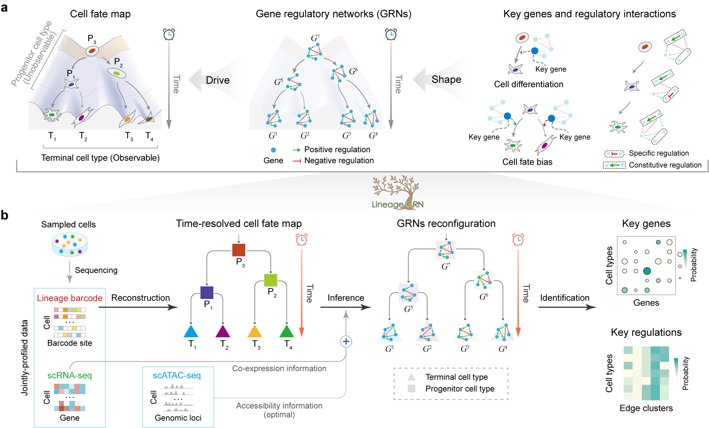

.. RegArch documentation master file, created by
   sphinx-quickstart on Tue Oct 29 17:29:50 2024.
   You can adapt this file completely to your liking, but it should at least
   contain the root `toctree` directive.

Welcome to RegArch documentation
================================================

.. raw:: html

   

RegArch
----------

RegArch aims to infer dynamic gene regulatory networks (GRNs) at a real-time scale using paired **single-cell lineage tracing** and **scRNA-seq** data obtained from the same cell, along with **scATAC-seq** datasets.
The inferred GRNs are linked by a time-scaled cell fate map representing developmental trajectories from progenitors to sampled descendant cell types.

   

Features
---------
The currently available features include:

- Inferring **time-scaled cell fate map**

- Inferring **dynamic gene regulatory networks**

- Revealing the **reconfiguration pattern** of GRNs along the cell lineage

- Identifying **key regulatory genes** driving **cell differentiation**

- Identifying **key regulatory genes** steering **cell fate bias**

- Identifying specific and constitutive **regulatory interactions**.

Reference
---------

Deciphering dynamic gene regulatory network underlying cell fate decisions in cell lineage

.. toctree::
   :maxdepth: 2
   :caption: Contents:

   installation
   tutorials/index
   api

